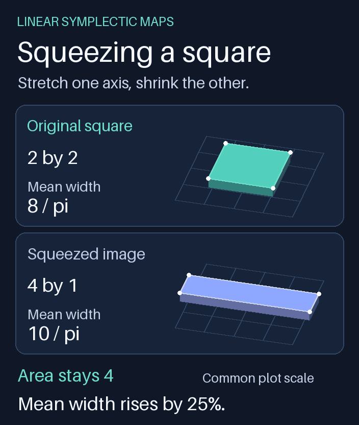

# Global mean-width minimization under linear symplectic maps

 ·  · 

A compact convex body with nonempty interior that is invariant under the simultaneous quarter-turn J minimizes mean width over its linear symplectic orbit. Equality holds exactly for orthogonal symplectic maps. This proves Ahn and Kerman’s Conjecture 1.6 for toric bodies and gives global linear minimality for the Lagrangian bidisk.

[Read the paper](paper/manuscript.pdf) · [LaTeX source](paper/manuscript.tex) · [Proof outline](proof/PROBLEM_AND_PROOF.md) · [Run the replay](REPRODUCIBILITY.md)

## Squeezing a square

In the plane, stretching one coordinate by 2 and shrinking the other by 1/2 preserves area and the standard symplectic form. The mean width increases by 25%. The square has quarter-turn symmetry, and its shape changes under other angles.

[Download the offline explorer](https://raw.githubusercontent.com/DannyExperiments/global-symplectic-mean-width/refs/tags/v1.0.0/visualization/squeezing-a-square-explorer.zip), extract it, and open `index.html`. Choose a squeeze factor to see the exact mean width, ratio and Gaussian covariance used in the proof. [Figure guide](visualization/README.md)

## Prior work and scope

Ahn and Kerman’s corrected v3 withdrew their earlier global toric proof in Remark 1.7. Their Theorem 1.4 and Proposition 1.12 give local linear results, including the bidisk in Proposition 1.12. Green’s planar theorem already gives the planar inequality. The result here ranges over linear symplectic maps in every even dimension. The nonlinear bidisk first derivative and the authors’ nonlinear global conjecture remain separate from this argument.

[Corrected Conjecture 1.6](https://arxiv.org/pdf/2311.02870v3#page=2) · [Earlier version](https://arxiv.org/html/2311.02870v2) · [Follow-up](https://arxiv.org/html/2602.07220#S3) · [Pinned Q1223](https://github.com/10m-u/open-problems-catalog/blob/ca8d4d44ba3db527f19f28928c240168f545ecfe/problems/mathematics/geometry-differential-geometry-part-1.md#q1223)

[Mathematical audit](audits/public_safe_reports/MATHEMATICAL_AUDIT.md) · [Literature audit](audits/public_safe_reports/LITERATURE_AUDIT.md) · [Scope](CLAIM_SCOPE_AND_LIMITATIONS.md) · [AI disclosure](AI_DISCLOSURE.md) · [Status](STATUS.md)

[Release v1.0.0](https://github.com/DannyExperiments/global-symplectic-mean-width/releases/tag/v1.0.0) · [Version DOI](https://doi.org/10.5281/zenodo.24574098) · [Citation](CITATION.cff)
